# 💎 Spendly — Smart Expense Tracker & Personal Budget Manager

<p align="center">
  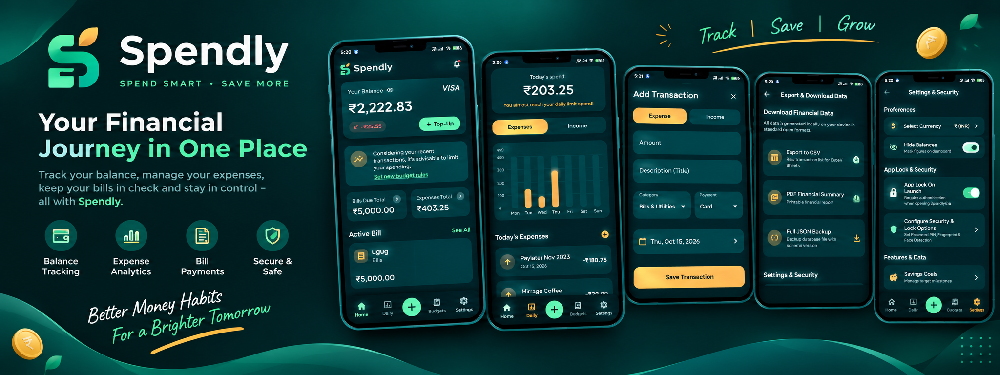
</p>

<p align="center">
  
  
  
  
  
</p>

---

## 📖 Overview

**Spendly** (SpendWise) is a premium, production-quality, 100% offline personal finance management application built with **Flutter**, **Dart**, and **GetX**. Designed with an elegant Dark Teal (`#092B30`) and Metallic Gold (`#D4AF37`) fintech aesthetic, **Spendly** helps users track expenses, manage budgets, schedule recurring bills, monitor savings goals, analyze interactive spending trends, and secure financial records using native device biometrics — **without relying on any external cloud or backend service**.

---

## 📱 App UI Gallery

### Featured Showcase
<p align="center">
  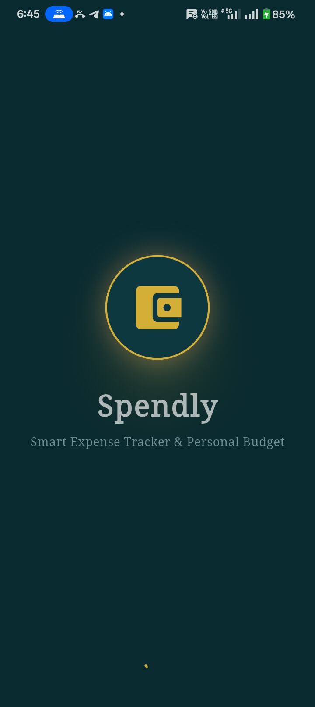
  
</p>

### Complete Screen Flow (1 - 9)
<p align="center">
  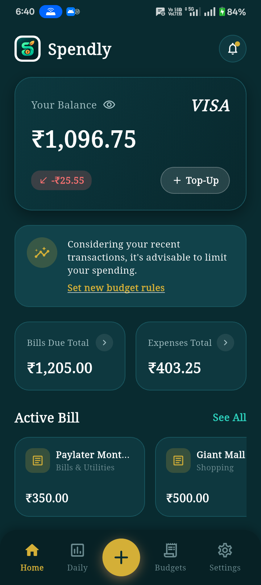
  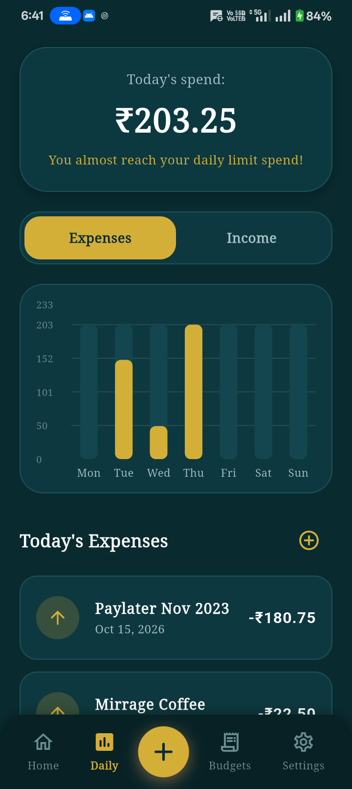
  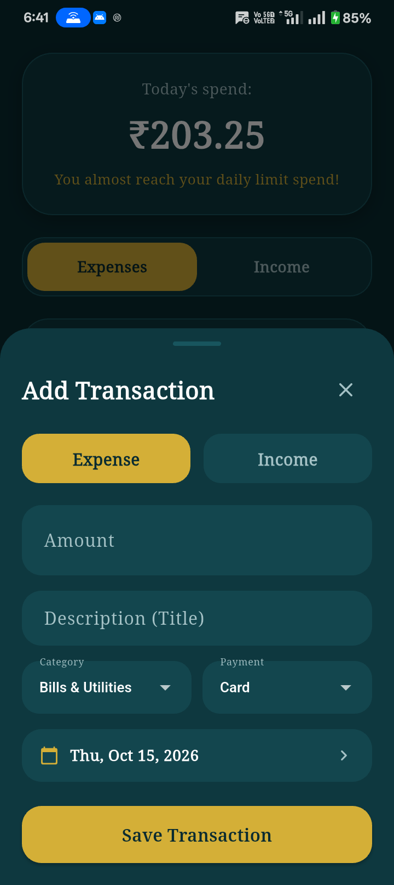
</p>

<p align="center">
  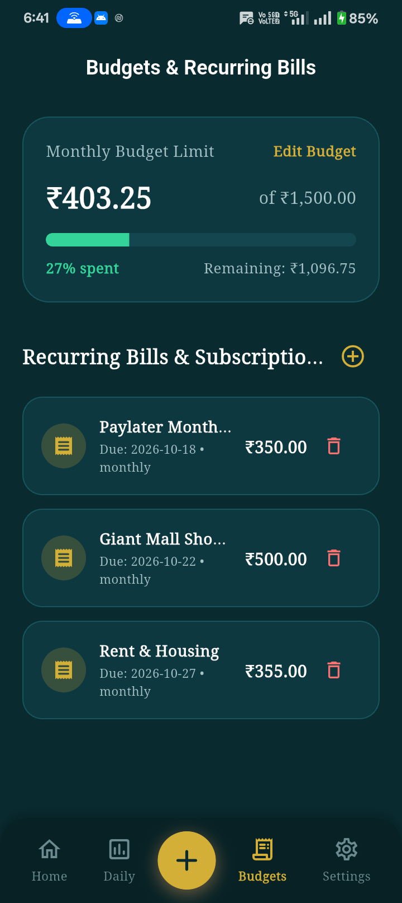
  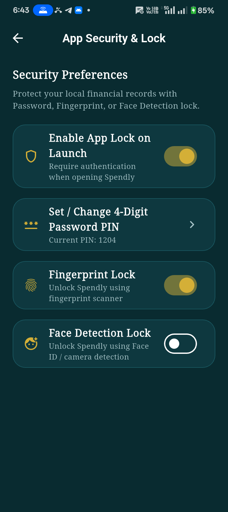
  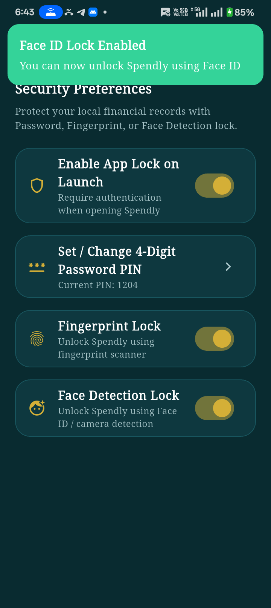
</p>

<p align="center">
  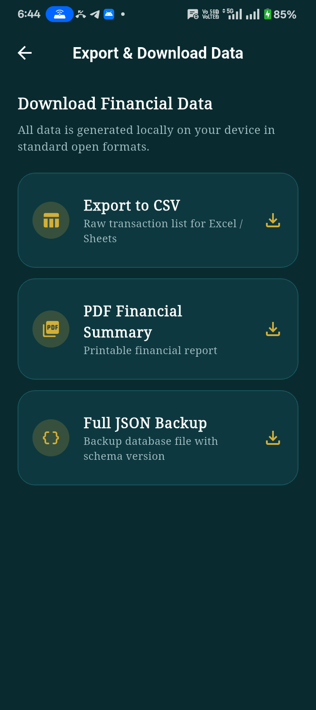
  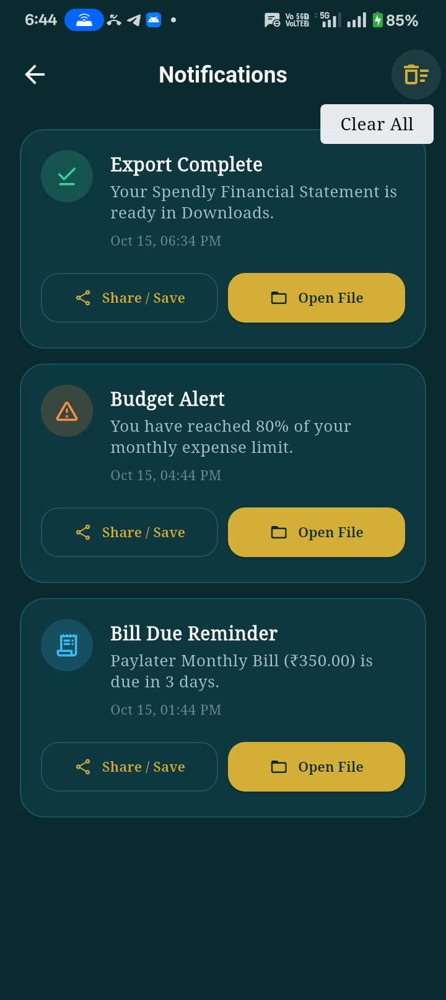
  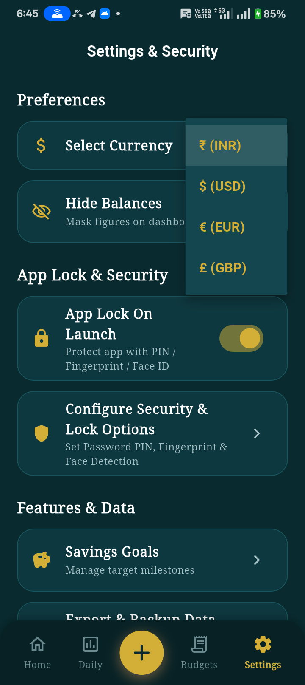
</p>

---

## ✨ Key Features & Technical Highlights

### 1. 🎨 Premium Fintech Design System
- **Color Palette**: Dark Teal (`#092B30` / `#0E383F`) background paired with Metallic Gold (`#D4AF37`), Soft Emerald Income (`#34D399`), and Coral Red Expense (`#F87171`).
- **Typography**: Google Fonts **Noto Serif** for an editorial, elegant, high-end financial feel.
- **Glassmorphic VISA Card**: Dynamic card displaying balance (`₹2,222.83`), downward trend change (`-₹25.55`), `+ Top-Up` button, and eye privacy toggle.
- **Shimmer Skeleton Loading**: Custom `ShimmerSkeleton` placeholders during data refresh for smooth user experience.

### 2. 🏠 Home Dashboard
- **Live Net Balance**: Dynamically calculated from total historical income minus total expenses (`sum(income) - sum(expenses)`).
- **Smart Recommendation Banner**: Automated alert advising limit spending when monthly budget thresholds are approached.
- **Summary Cards**: Side-by-side cards for **Bills Due Total** and **Expenses Total**.
- **Active Bills Carousel**: Horizontal scrolling list displaying upcoming recurring bills.

### 3. 📊 Daily Spend & Complete Expense Tracker
- **Today's Spend Header**: Leafy pattern banner displaying today's total spending and daily limit warning.
- **Interactive Mon–Sun Bar Chart**: Weekly spending trend visualization built using `fl_chart`.
- **Segmented Toggle**: Fast toggle between **Expenses** and **Income**.
- **Transaction CRUD**: Quick add/edit bottom sheet dialog with amount input, title, category selector, payment method (`Card`, `UPI`, `Cash`, `Net Banking`, `Transfer`), and date picker.
- **Transaction Tiles**: Circular badges (`↑` for expense, `↓` for income) displaying title, formatted date, and amount in Rupee (`₹`).

### 4. 🎯 Smart Budgeting & Recurring Bills
- **Monthly Budget Limits**: Overall monthly budget progress bar with warning states (75% warning, 90% danger, 100% exceeded).
- **Recurring Bills Scheduler**: Track subscriptions, rent, electricity, and paylater bills with due date tracking and payment status.

### 5. 📈 Interactive Analytics & Local Insights
- **Category Spending Doughnut Chart**: Interactive pie chart breaking down spending percentages by category.
- **Automated Local Financial Insights**:
  - Highest Spending Category
  - Average Daily Spending Velocity
  - Estimated Month-End Projected Spend

### 6. 🔒 App Security & Biometric Lock System
- **4-Digit Password PIN Lock**: Custom security PIN stored securely in local preferences.
- **Native Android Hardware Biometrics**: Integrated `local_auth` and native Android `BiometricPrompt` supporting **Fingerprint Scanner** and **Face Detection ID**.
- **Dynamic Lock Screen (`AppLockScreen`)**: Automatically prompts for biometric or PIN unlock when app security is enabled.
- **Auto-Verification**: Toggling biometric switches in Settings requires live biometric verification before saving.

### 7. 📑 Local Data Export & Backup
- **CSV Export**: Raw transaction log for Excel or Google Sheets.
- **Genuine Binary PDF Financial Statement**: Clean, professionally formatted `%PDF-1.4` binary PDF report featuring executive summary tables and transaction log.
- **Full JSON Backup**: Complete database backup with schema versioning for easy restore.
- **Native FileProvider Integration**: Uses Android `FileProvider` (`com.spendly.app.spendly.fileprovider`) to open exported PDF, CSV, and JSON files directly in native device file viewers.

### 8. 🔔 Local Notifications & Offline Privacy
- **Local Export Alerts**: Displays banner notifications when file exports complete, with direct **OPEN FILE** / **Share** actions.
- **100% Offline**: All data stored locally in SQLite (`sqflite`). Zero cloud dependencies, zero external tracking, zero Firebase.

---

## 🛠 Tech Stack & Dependencies

| Library / Package | Version | Purpose |
| :--- | :--- | :--- |
| **Flutter SDK** | `>=3.0.0` | Cross-platform framework |
| **Dart** | `>=3.13.5` | Programming language |
| **GetX** | `^4.7.3` | State management, DI, & navigation |
| **SQFLite** | `^2.4.4+1` | Offline SQLite local database |
| **FL Chart** | `^1.2.0` | Interactive charts (Bar chart, Pie/Doughnut chart) |
| **Local Auth** | `^2.3.0` | Device fingerprint & Face ID biometric authentication |
| **Shimmer** | `^3.0.0` | Skeleton loading effects |
| **Google Fonts** | `^6.3.3` | Noto Serif typography |
| **Intl** | `^0.19.0` | Date and currency formatting |
| **Path Provider** | `^2.1.6` | Access device Downloads and documents storage |
| **URL Launcher** | `^6.3.2` | Launch native file URIs and file locations |
| **Shared Preferences** | `^2.5.6` | App preferences (Currency, Hide Balance, Security PIN) |

---

## 🏗 Architecture & Project Structure

Organized cleanly by feature module following **GetX Pattern** and clean architecture:

```
lib/
├── main.dart                          # Application entry point
├── app/
│   ├── bindings/
│   │   └── initial_binding.dart       # Global GetX controller bindings
│   ├── routes/
│   │   ├── app_pages.dart             # Route page definitions
│   │   └── app_routes.dart            # Named route constants
│   └── theme/
│       ├── app_colors.dart            # Dark Teal & Metallic Gold color palette
│       ├── app_theme.dart             # Material 3 dark/light themes
│       └── app_typography.dart        # Noto Serif text theme
├── core/
│   ├── database/
│   │   └── db_helper.dart             # SQLite database helper & schema
│   ├── services/
│   │   ├── notification_service.dart  # Local notification manager
│   │   └── storage_service.dart       # SharedPreferences wrapper
│   ├── utils/
│   │   ├── biometric_helper.dart      # Device biometric hardware helper
│   │   ├── currency_formatter.dart   # Rupee (₹) currency formatter
│   │   ├── date_formatter.dart       # Date formatting utilities
│   │   └── export_helper.dart         # CSV, JSON, and PDF generator
│   └── widgets/
│       ├── custom_button.dart        # Styled action button
│       ├── custom_card.dart          # Rounded card container
│       ├── empty_state_widget.dart   # Empty state placeholder
│       ├── processing_overlay.dart    # Square Cupertino loading overlay
│       ├── shimmer_skeleton.dart     # Shimmer loading placeholders
│       └── transaction_tile.dart     # Transaction item row
├── features/
│   ├── analytics/                    # Category Pie Chart & Insights
│   ├── budgets/                      # Monthly Budget & Recurring Bills
│   ├── export/                       # CSV, PDF, JSON Export View
│   ├── home/                         # Dashboard, VISA Card, Active Bills
│   ├── navigation/                   # 5-Tab Bottom Nav Bar & FAB
│   ├── notifications/                # Notifications History Screen
│   ├── savings_goals/                # Target Milestones & Contribution
│   ├── security/                     # App Lock & PIN / Biometric Keypad
│   ├── settings/                     # Currency, Privacy, App Lock Settings
│   ├── splash/                       # Animated Splash Screen
│   └── transactions/                 # Daily Spend, Bar Chart, Add Sheet
└── models/
    ├── budget_model.dart             # Budget data model
    ├── category_model.dart           # Expense/Income category model
    ├── notification_model.dart       # Notification data model
    ├── recurring_model.dart          # Recurring bill model
    ├── savings_goal_model.dart       # Savings goal model
    └── transaction_model.dart        # Transaction data model
```

---

## 🚀 Getting Started

### Prerequisites
- [Flutter SDK](https://docs.flutter.dev/get-started/install) installed (version 3.20.0 or newer)
- Android Studio / VS Code with Flutter extension
- Connected Android device or Emulator (API 23+ for biometrics support)

### Installation & Run Steps

1. **Clone the Repository**:
   ```bash
   git clone https://github.com/your-username/spendly.git
   cd spendly
   ```

2. **Install Dependencies**:
   ```bash
   flutter pub get
   ```

3. **Run Static Analysis**:
   ```bash
   flutter analyze
   ```

4. **Run Unit Tests**:
   ```bash
   flutter test
   ```

5. **Run the Application**:
   ```bash
   flutter run
   ```

---

## 🧪 Testing & Quality Assurance

- **Unit Tests**: Executed via `flutter test` testing `TransactionModel` serialization, `CurrencyFormatter` Rupee formatting, `SavingsGoalModel` progress logic, and `DateFormatter`.
- **Static Analysis**: Verified with `flutter analyze` ensuring **0 compilation errors**.

---

## 🛡 Privacy & Security Statement

- **100% Local Data Storage**: All transactions, budgets, recurring bills, and preferences are stored strictly on your device inside an offline SQLite database (`spendwise_v1.db`).
- **No Cloud Synchronization**: Spendly requires no user account, no login, no backend server, and no cloud database. Your financial privacy is completely protected.

---

<p align="center">
  Crafted with ❤️ using <b>Flutter & Dart</b>
</p>
